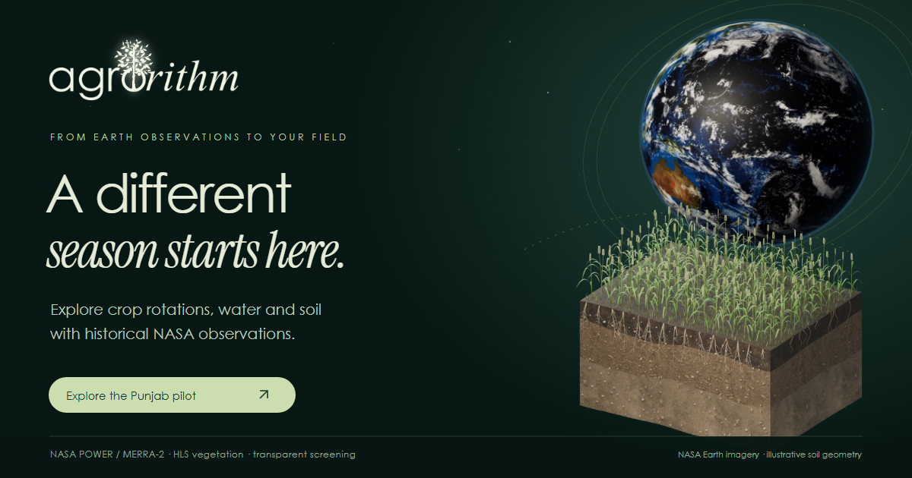

# Agrorithm

**A different season starts here.**

[Open Agrorithm on GitHub Pages](https://sspace0.github.io/Agrorithm/) · [Public repository](https://github.com/sspace0/Agrorithm) · [Review PR #1](https://github.com/sspace0/Agrorithm/pull/1) · [Deployment record](docs/PUBLIC_DEPLOYMENT.md)

A static crop-rotation exploration tool for a configurable Punjab, Pakistan pilot. NASA POWER weather and quality-filtered HLS vegetation provide regional historical context. Local inputs, stated crop assumptions and a transparent decision engine help compare a baseline with two alternatives over the same 36 months.



Built for NASA Space Apps 2026's [“Field Shift: Adapting Farms with NASA Data” challenge](https://www.spaceappschallenge.org/2026/challenges/adapting-farms-with-nasa-data/). This is a scientific screening prototype, not a validated irrigation prescription or yield forecast.

## Public release and source review

The repository is **public**, and the working prototype is live at **[sspace0.github.io/Agrorithm](https://sspace0.github.io/Agrorithm/)**. The source remains on [`feat/fieldshift-pilot`](https://github.com/sspace0/Agrorithm/tree/feat/fieldshift-pilot), with [PR #1](https://github.com/sspace0/Agrorithm/pull/1) open and unmerged. Publishing a reviewed artifact does not merge the source PR.

GitHub Pages serves the dedicated `gh-pages` artifact branch. Its [release record](https://sspace0.github.io/Agrorithm/release.json) identifies the exact published source revision; local and feature-branch changes are not live until that artifact is updated. The [alternate public host](https://fieldshift-jt1.spacetime24.chatgpt.site/) has its own recorded release history. See [publication evidence and update instructions](docs/PUBLIC_DEPLOYMENT.md).

## Run locally

Node 24 and pnpm 11.25.0:

```sh
pnpm install --frozen-lockfile
pnpm dev
pnpm typecheck
pnpm lint
pnpm test
pnpm build
pnpm preview --port 4173
pnpm exec playwright install chromium
pnpm test:e2e
```

Production preview: `http://127.0.0.1:4173/Agrorithm/`. The build is entirely static. No login, paid API, application server or database is required. [Setup and Pages instructions](docs/SETUP.md).

## Explore

| Route after `/Agrorithm/` | Experience                                                              |
| -------------------------- | ----------------------------------------------------------------------- |
| `#/`                       | Earth-to-map opening, sample, new plan, resume, motion and quality        |
| `#/studio/lab`             | Field Studio — default editorial workspace                              |
| `#/console/lab`            | Agronomist Console — compact quantitative workspace                     |
| `#/companion/setup`        | Farmer Companion — guided touch-friendly steps                          |
| `#/atlas`                  | World climate zones, crop graphics, soil filters and location selection |
| `#/soil`                   | Root-zone / groundwater cutaway and process explorer                    |
| `#/crops`                  | Eight crop references and four shared crop-category models              |
| `#/weather-patterns`       | Historical weather-pattern exploration                                  |
| `#/help`                   | Searchable, source-linked explanations                                  |
| `#/sources`                | Evidence, assumptions and boundaries                                    |
| `#/about`                  | Team jt_1                                                               |
| `#/design`                 | Separate desktop/mobile concept review                                  |

All concepts share the same six-step planning journey and engine: setup → evidence → rotation lab → what-if → trade-offs → export. Input state persists when changing routes. Save/resume/delete use local device storage. Print/PDF, JSON and CSV exports include assumptions and provenance. The production cache supports offline sample use after its first successful installation.

## What is real, assumed and modeled

- **Genuine observations:** 2,557 NASA POWER / MERRA-2 UTC days (1 January 2018–31 December 2024), and 43 NASA/USGS HLS L30 v2.0 acquisitions in 2023. POWER weather drives ET, simplified irrigation accounting and historical exposure. HLS NDVI supports observed live-cover interpretation and farmer confirmation; it does not identify crops, measure residue or directly change rotation scores. Missing/poor-quality observations remain gaps; per-scene identifiers, coverage and valid pixels are recorded.
- **Demonstration inputs:** the regional sample's maize–wheat baseline, soil, dates, equipment, markets, irrigation efficiency and water limit. This is not an interviewed or surveyed farm. No rice–wheat baseline is imposed.
- **Screening calculations:** calendar/access/water constraints, FAO radiation/Hargreaves ET0, stage Kc and a carrying daily root-zone bucket, exposure, cover/diversity, four historical replays, Pareto comparison and six sensitivity cases.
- **Illustration:** soil horizons, roots, process particles and a user-controlled groundwater level. Groundwater is pore water in solid material; no field depth is inferred from SMAP/GRACE.

The app does not predict yield, profit, fertilizer replacement, carbon improvement, aquifer dynamics or erosion reduction. Paddy ET is incomplete for total rice irrigation and rice remains unresolved. A local soil test, cultivar review and farmer/agronomist feedback are required before real-world use. Software checks are not agronomic validation. The incomplete Urdu translation control has been removed; the current interface is English.

Cover, family diversity, stated residue retention and water exposure are soil-health proxies. They do not measure soil carbon, nutrients, biology or structure. Historical weather perturbations are hypothetical stress tests, not forecasts, and missing evidence can prevent ranking. Orchard references are excluded from the annual rotation engine.

## Editable visual sources

- Editable root-zone, groundwater, Earth and crop-category scenes in [`assets/blender/`](assets/blender/), with model-specific notes.
- [Generation/export script](assets/blender/generate_v2.py) and [groundwater detail script](assets/blender/enhance_groundwater.py); Blender 5.2.1 was run to create, export and render the scenes.
- Runtime GLBs in `public/models/`; immediate/fallback posters in `public/images/`.
- Permitted PBR sources, creators, URLs, licenses, checksums and modifications in [asset credits](docs/ASSET_CREDITS.md) and `assets/textures/manifest.json`.

The original jt_1 artwork is preserved; the About page uses the supplied Agrorithm logo. Branding is centralized in `src/config.ts`. `deployment.config.json` defaults to `/Agrorithm/`; `DEPLOY_BASE` independently overrides the deployment subpath and service-worker scope.

## Project notebook

[Methods](docs/METHODS.md) · [Data registry](docs/DATA_REGISTRY.md) · [Build specification](docs/BUILD_SPEC.md) · [Design rationale and previews](docs/design/README.md) · [Verification results](docs/VERIFICATION.md) · [Demo walkthrough](docs/DEMO.md) · [Import schemas](docs/IMPORTS.md) · [Blank feedback template](public/data/feedback-template.md) · [Team](docs/TEAM.md).

CI verifies the locked install, types, lint, engine tests, static build and browser journeys. Source pushes and PR creation do not publish the current site; updates to the selected `gh-pages` artifact branch publish that reviewed build. No automatic PR merge is configured. The source also includes a manually triggered official-actions Pages workflow with scoped permissions and the `github-pages` environment, available after it reaches the default branch through an authorized review and merge. The active branch-based deployment and observed live checks are recorded in [public deployment](docs/PUBLIC_DEPLOYMENT.md).

The opening page rotates a NASA-textured Earth in space and transitions into a satellite atlas. Model pages share large, transparent, scroll-driven presentations with manual orbit, cursor-centered Ctrl+wheel zoom, reset, collision-aware labels and static reduced-motion equivalents. Every major area has its own static-safe hash URL. Century Gothic is the primary local font; bundled DM Sans supplies a licensed fallback and Instrument Serif supplies italic accents. See [atlas methods](docs/ATLAS.md) for the limits of global crop/soil interpretation.

## Updated experience
Explore the eight crop references and four shared category models at #/crops, search the satellite atlas at #/atlas, or find source-linked explanations at #/help. Global Search (Ctrl/Cmd K) opens pages and tools. See docs/EXPERIENCE_UPDATE.md for measurements, screenshots and scientific scope. The complete static core builds for /Agrorithm/.

The presentation PDF uses dynamically paginated 1920 × 1080 sheets with a supplied cover, vector charts, all inputs and outcomes, feasibility, sensitivities and provenance. See [report export](docs/REPORT_EXPORT.md), [visual QA](docs/VISUAL_QA.md), and the [sample PDF](output/pdf/Agrorithm-sample-report.pdf).


The project now includes the historical NASA pattern lab and floating botanical-O helper, 24× satellite-map interaction, crop-to-plan preferences, wet-blue groundwater and guided soil-layer separation. The helper uses learned historical clustering and documented guidance; it is not a language model or forecast. See docs/ML_METHODS.md, docs/MODEL_REVIEW.md and docs/SCROLL_MAP_REVIEW.md.

The original social-preview composition is supplied as editable SVG and 1200 × 630 PNG in `public/images/social-preview.*`. Reproduce it with `node scripts/render-social-preview.mjs`. It reuses the project's authorized logo, historical NASA Earth image, illustrative Blender cutaway and licensed fonts; existing [asset credits](docs/ASSET_CREDITS.md) remain applicable.

## License

Original project code is available under the [MIT License](LICENSE). Third-party datasets, textures, fonts, software and supplied branding retain their own rights and terms described in [asset credits](docs/ASSET_CREDITS.md) and [third-party notices](THIRD_PARTY_NOTICES.txt). The project license does not relicense those assets or imply NASA endorsement.
