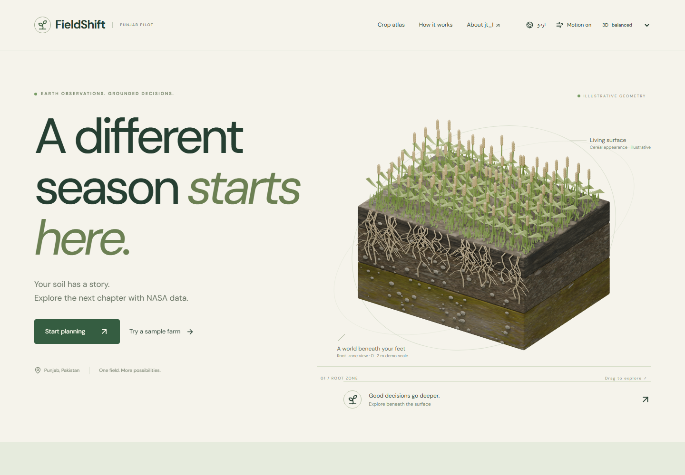

# FieldShift

**A different season starts here.**

[Open the public website](https://fieldshift-jt1.spacetime24.chatgpt.site) · [Deployment record](docs/PUBLIC_DEPLOYMENT.md)

A static crop-rotation exploration tool for a configurable Punjab, Pakistan pilot. NASA POWER weather and quality-filtered HLS vegetation provide regional historical context. Local inputs, stated crop assumptions and a transparent decision engine help compare a baseline with two alternatives over the same 36 months.



## Run locally

Node 24 and pnpm 11.25.0:

```sh
pnpm install --frozen-lockfile
pnpm dev
pnpm typecheck
pnpm lint
pnpm test
pnpm build
pnpm preview --port 4173
pnpm exec playwright install chromium
pnpm test:e2e
```

Production preview: `http://127.0.0.1:4173/FieldShift/`. The build is entirely static. No login, paid API, server, database or LLM key is required. [Setup and manual Pages instructions](docs/SETUP.md).

## Explore

| Route after `/FieldShift/` | Experience                                                              |
| -------------------------- | ----------------------------------------------------------------------- |
| `#/`                       | Interactive menu, sample, new plan, resume, language and quality        |
| `#/studio/lab`             | Field Studio — default editorial workspace                              |
| `#/console/lab`            | Agronomist Console — compact quantitative workspace                     |
| `#/companion/setup`        | Farmer Companion — guided touch-friendly steps                          |
| `#/atlas`                  | World climate zones, crop graphics, soil filters and location selection |
| `#/soil`                   | Root-zone / groundwater cutaway and process explorer                    |
| `#/sources`                | Evidence, assumptions and boundaries                                    |
| `#/about`                  | Team jt_1                                                               |
| `#/design`                 | Separate desktop/mobile concept review                                  |

All concepts share the same six-step planning journey and engine: setup → evidence → rotation lab → what-if → trade-offs → export. Input state persists when changing routes. Save/resume/delete use local device storage. Print/PDF, JSON and CSV exports include assumptions and provenance. The production cache supports offline sample use after its first successful installation.

## What is real, assumed and modeled

- **Genuine observations:** 2,557 POWER UTC days (2018–2024), and 43 HLS L30 v2.0 acquisitions in 2023. Missing/poor-quality satellite observations remain gaps; per-scene identifiers, coverage and valid pixels are recorded.
- **Demonstration inputs:** the regional sample's maize–wheat baseline, soil, dates, equipment, markets, irrigation efficiency and water limit. This is not an interviewed or surveyed farm. No rice–wheat baseline is imposed.
- **Screening calculations:** calendar/access/water constraints, FAO radiation/Hargreaves ET0, stage Kc and a carrying daily root-zone bucket, exposure, cover/diversity, four historical replays, Pareto comparison and six sensitivity cases.
- **Illustration:** soil horizons, roots, process particles and a user-controlled groundwater level. Groundwater is pore water in solid material; no field depth is inferred from SMAP/GRACE.

The app does not predict yield, profit, fertilizer replacement, carbon improvement, aquifer dynamics or erosion reduction. Paddy ET is incomplete for total rice irrigation and rice remains unresolved. A local soil test, cultivar review and farmer/agronomist feedback are required before real-world use. Software checks are not agronomic validation. Urdu navigation is provisional and requires fluent review.

## Editable visual sources

- [Root-zone Blender source](assets/blender/root-zone.blend) and [groundwater source](assets/blender/groundwater.blend).
- [Deterministic generation/export script](assets/blender/generate.py); Blender 5.2.1 LTS was run to create and render both scenes.
- Runtime GLBs in `public/models/`; immediate/fallback posters in `public/images/`.
- Permitted PBR sources, creators, URLs, licenses, checksums and modifications in [asset credits](docs/ASSET_CREDITS.md) and `assets/textures/manifest.json`.

The original jt_1 logo is preserved and used on the project team page. Branding is centralized in `src/config.ts`. `DEPLOY_BASE` independently controls the deployment subpath and service-worker scope.

## Project notebook

[Methods](docs/METHODS.md) · [Data registry](docs/DATA_REGISTRY.md) · [Build specification](docs/BUILD_SPEC.md) · [Design rationale and previews](docs/design/README.md) · [Verification results](docs/VERIFICATION.md) · [Demo walkthrough](docs/DEMO.md) · [Import schemas](docs/IMPORTS.md) · [Blank feedback template](public/data/feedback-template.md) · [Team](docs/TEAM.md).

CI verifies the locked install, types, lint, engine tests, static build and browser journeys. Pages deployment is **manual only**; nothing publishes or merges automatically. Private-repository Pages eligibility/settings may require owner action. GitHub Pages has not been deployed; the public Sites deployment is recorded in docs/PUBLIC_DEPLOYMENT.md.

The opening page includes a scroll-driven soil cutaway with a static reduced-motion equivalent. Every major area has its own static-safe hash URL; the six planning steps are separate screens. One bundled DM Sans type family is used throughout. See [atlas methods](docs/ATLAS.md) for the limits of global crop/soil interpretation.

## Updated experience
Explore the eight crop references and four shared category models at #/crops, search the satellite atlas at #/atlas, or find source-linked explanations at #/help. Global Search (Ctrl/Cmd K) opens pages and tools. See docs/EXPERIENCE_UPDATE.md for measurements, screenshots and scientific scope. The complete static core still builds for /FieldShift/. No Gemini/API key is required.
