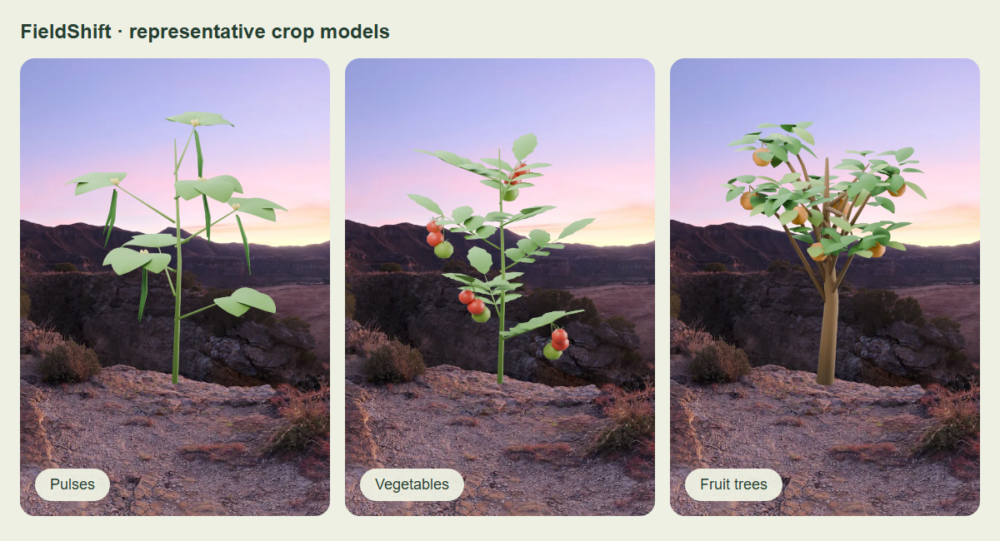

# Experience revision

The opening uses a forest palette, DM Sans, a fuller green cutaway and a native-scroll soil journey. Persistent navigation and Ctrl/Cmd K search reach separate hash pages: `#/atlas`, `#/soil`, `#/crops`, `#/help`, the six `#/studio/` planning steps, alternative `#/console/` and `#/companion/` concepts, and `#/design` for review. Feature-detected view transitions respect reduced motion. Reference sites informed composition and pacing; their assets/code are not copied.

The guide gives curated source-linked explanations, with honest unmatched states. No Gemini/model API is integrated. Map search accepts genuine cached towns, coordinates or an explicit public Open-Meteo request; editing invalidates pending results. Place selection jumps to the map. Weather and soil are never inferred from a place result.

| Group | Crop references | Shared model |
| --- | --- | --- |
| Grains | Wheat, maize | Maize |
| Pulses | Mungbean, chickpea | Mungbean |
| Vegetables | Tomato, potato | Tomato |
| Fruit trees | Citrus, mango | Citrus-style tree |

Category models do not depict every species. Their normalized 1.5 m presentation height does not compare natural heights. `src/data/cropProfiles.ts` provides temperature, planting/harvest, water, pH, drought and heat descriptions with primary sources, applicability and provisional flags. Unsupported local ranges remain unknown. Broader references do not silently expand the Punjab annual decision engine; orchards need different multi-year establishment rules.

## Measurements

Blender 5.2.1 LTS ran locally. Editable sources/scripts, GLBs and inspected renders are included. Exact nodes, checksums, bounds and rendering checks are in `assets/blender/validation-v2.json` and `validation-crops.json`.

| Model | Triangles | GLB bytes | Local gzip bytes |
| --- | ---: | ---: | ---: |
| Root-zone v2 | 138,786 | 7,705,588 | 5,749,173 |
| Groundwater v2 | 32,662 | 5,309,612 | 4,552,733 |
| Grains | 11,296 | 234,696 | 135,844 |
| Pulses | 3,732 | 83,372 | 55,815 |
| Vegetables | 5,992 | 138,004 | 89,351 |
| Fruit trees | 11,472 | 258,036 | 189,471 |

Soil posters: 188,574 / 72,942 bytes. Four crop posters total 158,534 bytes; four GLBs total 714,108 raw bytes. Landscape WebP: 168,920 bytes. Supplied background derivative: 28,424 bytes. Gzip measurements do not assert live transfer sizes.

Phones/Save-Data clients start with soil posters at automatic quality. Crop 3D always requires an explicit request. Optional models are excluded from offline precaching and cached after use. Offscreen/hidden rendering pauses; pixel ratio is bounded to 1–1.5 (low quality 1). Static mode retains the planning journey. No physical phone/laptop FPS, battery benchmark or agronomic validation is claimed.

## Verification

TypeScript, ESLint, 23 unit tests and production build pass. The 20-test production-browser suite covers `/FieldShift/`, all three planning concepts, offline sample/map, exports, failed data requests, missing models, WebGL context loss, global/map/guide search, eight profiles, four category graphics, opt-in models and phone poster defaults. Independent review verified corrected front-face groundwater markers and discarded stale search responses. Direct browser geocoding returned HTTP200, response type `cors`. The 390px header is 106px high with no document overflow.

Screenshots are in `docs/design/redesign/`. Local calendars/varieties, unknown orchard water totals and Urdu still need appropriate review. Detailed profiles are references, not automatic engine thresholds or irrigation prescriptions.

